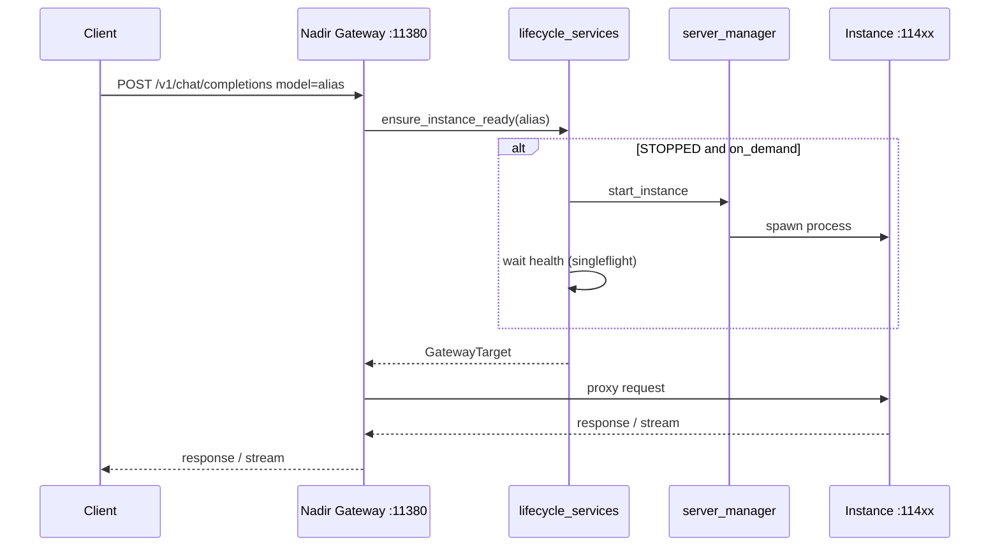

# Instance lifecycle — wake on demand & idle offload

Operator guide for Ollama-like **sleep / wake** behaviour on Nadir MLX.

!!! note "Prerequisite"
    Nadir Gateway (`:11380`) must be running. See [nadir-gateway.md](nadir-gateway.md).

## Concepts

| Term | Meaning |
|------|---------|
| **always_on** | Instance stays running until manually stopped (default, pre-v0.3 behaviour) |
| **on_demand** | Instance may be **stopped** when idle; gateway **wakes** it on first request |
| **Idle offload** | Background watcher stops `on_demand` instances after `idle_minutes` without traffic |
| **LRU eviction** | Before starting a model, stop least-recently-used `on_demand` instances if free memory is below the pending footprint (+ reserve) |
| **Eviction grace** | Instances touched within the grace window are not evictable (default 60s, at least `2 ×` activity heartbeat) |
| **Activity heartbeat** | Gateway refreshes `last_used_at` ~every 15s during long JSON calls and SSE streams (including prefill waits) |
| **Startup reconcile** | On app boot, `always_on` instances left `STOPPED`/`FAILED` (e.g. after host reboot) are restarted |
| **Cold start** | Time to load weights into unified memory after wake |

## Per-instance configuration

Set in the instance **server config** (UI advanced / ops section):

| Key | Values | Default |
|-----|--------|---------|
| `lifecycle_mode` | `always_on`, `on_demand` | `always_on` |
| `idle_minutes` | 5–1440 | `30` |

Recommendations:

- Primary chat model → `always_on`
- TTS, STT, image, reranker, secondary chat → `on_demand` with `idle_minutes` 15–60

## Environment variables

| Variable | Default | Description |
|----------|---------|-------------|
| `NADIR_GATEWAY_WAKE_TIMEOUT_SECONDS` | `300` | Max wait for instance to become RUNNING after wake |
| `NADIR_IDLE_OFFLOAD_ENABLED` | `true` | Global switch for idle watcher |
| `NADIR_IDLE_CHECK_INTERVAL_SECONDS` | `60` | How often idle candidates are evaluated |
| `NADIR_LRU_EVICTION_ENABLED` | `true` | Evict LRU `on_demand` instances under memory pressure before load |
| `NADIR_LRU_EVICTION_GRACE_SECONDS` | `60` | Min idle age before LRU eviction; floored to `2 ×` heartbeat |
| `NADIR_GATEWAY_ACTIVITY_HEARTBEAT_SECONDS` | `15` | Refresh `last_used_at` during long requests / streams |
| `NADIR_MEMORY_RESERVE_GB` | `4` | Free-memory headroom (GiB) kept when deciding to evict |
| `MLX_INSTANCE_STARTUP_RECONCILE_ENABLED` | `true` | Restore `always_on` instances after process/host restart |

!!! note "always_on is never LRU-evicted"
    Only `lifecycle_mode=on_demand` instances are candidates. Primary chat models should stay `always_on`.

!!! tip "Long generations stay protected"
    `last_used_at` is updated at request start, on a mid-request heartbeat (JSON background task and SSE, including mlx-lm prefill before the first token), and at request/stream end. That keeps active instances outside the eviction grace and idle-offload windows without a multi-minute lockout after every call. Heartbeat failures are best-effort (logged, never abort inference).

## Host / process restart

After a host reboot or Nadir process restart:

1. Health reconcile marks orphan `RUNNING` rows (dead PIDs) as `STOPPED`/`FAILED`.
2. **Startup reconcile** restarts every **`always_on`** instance in `STOPPED`/`FAILED`.
3. **`on_demand`** instances stay stopped until the next gateway request (wake-on-request).

This is independent of `ops.auto_restart` (runtime crash recovery while the app stays up). Disable with `MLX_INSTANCE_STARTUP_RECONCILE_ENABLED=false` if needed.

## Request flow

## Client timeouts

For **`on_demand`** instances, set client request timeouts ≥ `NADIR_GATEWAY_WAKE_TIMEOUT_SECONDS` (default 300s). Large VLMs may need 180–300s on first request after sleep.

Clients only need the **gateway alias** in `model` and `api_base` `http://<host>:11380/v1` — no per-instance port.

## Gateway errors

| HTTP | Code | When |
|------|------|------|
| 503 | `model_waking` | Wake in progress (rare if connection is held) |
| 503 | `model_waking_timeout` | Wake exceeded timeout |
| 503 | `model_unavailable` | `always_on` but stopped, or FAILED |

## Verification

1. Create instance with `lifecycle_mode: on_demand`, stop it from UI → status **Stopped**.
2. `curl` chat completion via gateway with `model: <alias>` → succeeds after cold start.
3. Wait `idle_minutes` + one check interval → instance returns **Stopped**, RAM freed.
4. `GET /v1/models` lists alias with `nadir.status` / `nadir.lifecycle_mode` extensions.

## Troubleshooting

| Symptom | Check |
|---------|--------|
| Immediate 503 on stopped alias | `lifecycle_mode` still `always_on` |
| Timeout on first request | Increase client timeout and `NADIR_GATEWAY_WAKE_TIMEOUT_SECONDS` |
| Instance never sleeps | Traffic still hitting instance port directly (bypass gateway) |
| Instance sleeps / is LRU-evicted during long stream or prefill | Confirm activity heartbeat is enabled; set `NADIR_LRU_EVICTION_GRACE_SECONDS` ≥ `2 ×` `NADIR_GATEWAY_ACTIVITY_HEARTBEAT_SECONDS` |
| `always_on` still down after reboot | Confirm `MLX_INSTANCE_STARTUP_RECONCILE_ENABLED`; check logs for `Startup reconcile` |

## Related

- [Coverage matrix](nadir-gateway-coverage-matrix.md)
- [Nadir Gateway](nadir-gateway.md)
