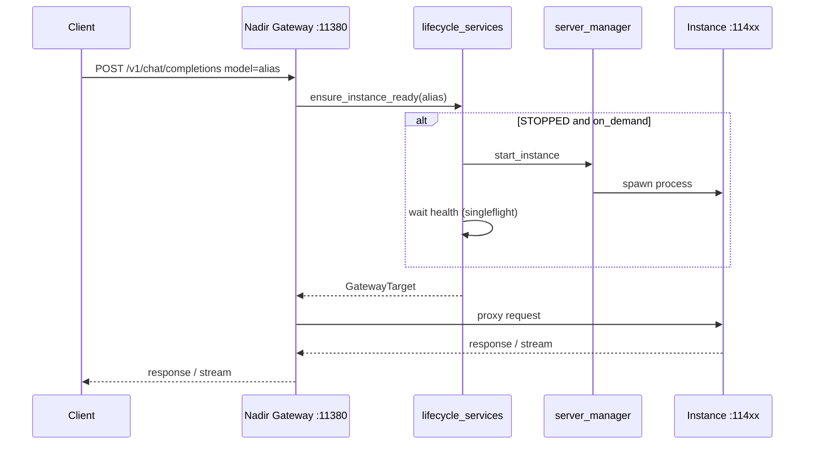

# Instance lifecycle — wake on demand & idle offload

Operator guide for Ollama-like **sleep / wake** behaviour on Nadir MLX.

!!! note "Prerequisite"
    Nadir Gateway (`:11380`) must be running. See [nadir-gateway.md](nadir-gateway.md).

## Concepts

| Term | Meaning |
|------|---------|
| **always_on** | Instance stays running until manually stopped; restored after host/app reboot (default) |
| **on_demand** | Instance may be **stopped** when idle; gateway **wakes** it on first request |
| **manual** | Never auto-started on boot and never gateway-woken — start/stop only from the Servers UI (large models) |
| **Idle offload** | Background watcher stops `on_demand` instances after **per-instance** `idle_minutes` without traffic |
| **Pinned** | Never selected as an LRU victim under memory pressure (idle offload still applies when `on_demand`) |
| **Warmup** | After load/wake, a 1-token generation pays Metal shader compile before the first user request |
| **Speculative wake** | Optional background wake on `GET /v1/models/{id}` or Ollama `/api/show` |
| **LRU eviction** | Before starting a model, stop least-recently-used unpinned `on_demand` instances if free memory is below the pending footprint (+ reserve) |
| **Eviction grace** | Instances touched within the grace window are not evictable (default 60s, at least `2 ×` activity heartbeat) |
| **Activity heartbeat** | Gateway refreshes `last_used_at` ~every 15s during long JSON calls and SSE streams (including prefill waits) |
| **Startup reconcile** | On app boot, `always_on` instances left `STOPPED`/`FAILED` (e.g. after host reboot) are restarted |
| **Cold start** | Time to load weights (+ optional warmup) after wake; surfaced as wake latency marked **cold** on the Servers page |
| **Desired state** | Persisted intent (`running` / `stopped`) separate from the observed `status`; automatic actors never override `stopped` |
| **Slot lock** | Cross-process exclusive lock per port serializing every start / stop / restart |

## Per-instance configuration

Set in the instance **server config** (UI advanced / ops section):

| Key | Values | Default |
|-----|--------|---------|
| `lifecycle_mode` | `always_on`, `on_demand`, `manual` | `always_on` |
| `idle_minutes` | 5–1440 | `30` |
| `pinned` | bool | `false` |
| `warmup_on_load` | bool | `true` |
| `speculative_wake` | bool | `false` |

Recommendations:

- Primary chat model → `always_on` (optionally `pinned` if you also keep secondary `on_demand` models)
- Large / rarely used chat weights → `manual` (no boot restore, no wake — start from UI when needed)
- Frequently used secondary chat → `on_demand` + `pinned` + shorter `idle_minutes` (survives LRU, still sleeps)
- Rare TTS / STT / image → `on_demand` with `idle_minutes` 15–60
- Enable `speculative_wake` when clients probe `/v1/models/{id}` or Ollama `/api/show` before the first completion

## Environment variables

| Variable | Default | Description |
|----------|---------|-------------|
| `NADIR_GATEWAY_WAKE_TIMEOUT_SECONDS` | `300` | Max wait for instance to become RUNNING after wake |
| `NADIR_IDLE_OFFLOAD_ENABLED` | `true` | Global switch for idle watcher |
| `NADIR_IDLE_CHECK_INTERVAL_SECONDS` | `60` | How often idle candidates are evaluated |
| `NADIR_LRU_EVICTION_ENABLED` | `true` | Evict LRU `on_demand` instances under memory pressure before load |
| `NADIR_LRU_EVICTION_GRACE_SECONDS` | `60` | Min idle age before LRU eviction; floored to `2 ×` heartbeat |
| `NADIR_GATEWAY_ACTIVITY_HEARTBEAT_SECONDS` | `15` | Refresh `last_used_at` during long requests / streams |
| `NADIR_MEMORY_RESERVE_GB` | `4` | Free-memory headroom (GiB) kept when deciding to evict |
| `MLX_INSTANCE_STARTUP_RECONCILE_ENABLED` | `true` | Restore `always_on` instances after process/host restart |
| `MLX_INSTANCE_READY_TIMEOUT_SECONDS` | `300` | Max wait for `/health` after spawn before the start is marked `FAILED` |
| `NADIR_RUNTIME_STATE_DIR` | `data/runtime` | Slot lock files and route-cache generation stamp shared by UI, gateway and MCP |

!!! note "LRU victims"
    Only **unpinned** `lifecycle_mode=on_demand` instances are LRU candidates. `always_on` and `ops.pinned=true` are never stopped for memory headroom.

!!! tip "Long generations stay protected"
    `last_used_at` is updated at request start, on a mid-request heartbeat (JSON background task and SSE, including mlx-lm prefill before the first token), and at request/stream end. That keeps active instances outside the eviction grace and idle-offload windows without a multi-minute lockout after every call. Heartbeat failures are best-effort (logged, never abort inference).

## Start / stop coordination

Three processes act on instances: the UI (`runserver`), the gateway (wake, idle offload, LRU eviction, watchdog, startup reconcile) and the MCP server. They coordinate through two mechanisms ([ADR 009](https://github.com/assiadialeb/nadir-mlx/blob/main/adr/009-instance-slot-lock-desired-state.md)).

**Slot lock.** Every start, stop, restart, edit and delete holds an exclusive `flock` on `NADIR_RUNTIME_STATE_DIR/locks/port-<port>.lock`. The kernel releases it if the holder dies, so a crash never leaves a slot stuck. User-facing actions fail fast with *"A start or stop is already in progress"*; background actors (idle offload, eviction, watchdog, reconcile) skip the slot and retry on their next cycle.

**Desired state.** `InferenceInstance.desired_state` records intent:

| Actor | Sets `desired_state` |
|-------|----------------------|
| UI / MCP **Start**, gateway wake | `running` |
| UI / MCP **Stop**, idle offload, LRU eviction | `stopped` |
| Watchdog auto-restart, startup reconcile | never changed — they only act when it is `running` |

An unexpected exit of an `always_on` instance whose intent is `running` becomes `FAILED` (watchdog restarts it if `auto_restart` is enabled). Any other unexpected exit becomes `STOPPED` with intent `stopped`.

**Start sequence.** The UI returns immediately with an info toast; the launch runs in a worker thread that keeps the slot lock:

1. Row reserved as **Loading** (validation errors surface synchronously).
2. Process spawned; the row stays **Loading** until `/health` answers (timeout `MLX_INSTANCE_READY_TIMEOUT_SECONDS`).
3. Warmup generation (`warmup_on_load`), recorded as activity so idle offload does not fire right after load.
4. Row marked **Running**.

The Servers page refreshes itself every few seconds while a row is **Loading** or **Working…** (slot locked by another process), unless a modal is open or a form was edited.

**Stop during start.** Clicking Stop while a start is in flight records `desired_state=stopped` and shows *"Stop queued"*; the starter checks the intent between health polls and after warmup, then stops the process instead of marking it Running.

**PID identity.** Stored PIDs are trusted only when `ps` shows an `orchestrator.*` launcher bound to `--port <port>`. A recycled PID or a foreign program listening on the port is never signalled; the start fails with *"Port N is already in use by another program"* instead.

!!! warning "Shared runtime directory"
    When UI, gateway and MCP run in separate containers, mount the same `NADIR_RUNTIME_STATE_DIR` volume in all of them; otherwise the slot locks do not coordinate across processes.

## Host / process restart

After a host reboot or Nadir process restart:

1. Health reconcile marks orphan `RUNNING` rows (dead or recycled PIDs) as `STOPPED`/`FAILED`. Benchmarks left `RUNNING` by the dead process are marked `FAILED` (*Interrupted*).
2. **Startup reconcile** restarts every **`always_on`** instance in `STOPPED`/`FAILED` whose `desired_state` is `running` — a model stopped by the operator stays stopped across reboots.
3. **`on_demand`** instances stay stopped until the next gateway request (wake-on-request).
4. **`manual`** instances stay stopped until started from the Servers UI (no boot restore, no gateway wake).

This is independent of `ops.auto_restart` (runtime crash recovery while the app stays up). Disable with `MLX_INSTANCE_STARTUP_RECONCILE_ENABLED=false` if needed.

## Request flow

## Client timeouts

For **`on_demand`** instances, set client request timeouts ≥ `NADIR_GATEWAY_WAKE_TIMEOUT_SECONDS` (default 300s). Large VLMs may need 180–300s on first request after sleep.

Clients only need the **gateway alias** in `model` and `api_base` `http://<host>:11380/v1` — no per-instance port.

## Gateway errors

| HTTP | Code | When |
|------|------|------|
| 503 | `model_waking` | Wake in progress (rare if connection is held) |
| 503 | `model_waking_timeout` | Wake exceeded timeout |
| 503 | `model_unavailable` | `always_on` but stopped, or FAILED |

## Verification

1. Create instance with `lifecycle_mode: on_demand`, stop it from UI → status **Stopped**.
2. `curl` chat completion via gateway with `model: <alias>` → succeeds after cold start.
3. Wait `idle_minutes` + one check interval → instance returns **Stopped**, RAM freed.
4. `GET /v1/models` lists alias with `nadir.status` / `nadir.lifecycle_mode` extensions.

## Troubleshooting

| Symptom | Check |
|---------|--------|
| Immediate 503 on stopped alias | `lifecycle_mode` still `always_on` |
| Timeout on first request | Increase client timeout and `NADIR_GATEWAY_WAKE_TIMEOUT_SECONDS` |
| Instance never sleeps | Traffic still hitting instance port directly (bypass gateway) |
| Instance sleeps / is LRU-evicted during long stream or prefill | Confirm activity heartbeat is enabled; set `NADIR_LRU_EVICTION_GRACE_SECONDS` ≥ `2 ×` `NADIR_GATEWAY_ACTIVITY_HEARTBEAT_SECONDS` |
| `always_on` still down after reboot | Confirm `MLX_INSTANCE_STARTUP_RECONCILE_ENABLED`; check logs for `Startup reconcile`. Instances stopped by the operator stay stopped (`desired_state=stopped`) — start them once from the UI |
| *"A start or stop is already in progress"* | Another process holds the slot lock; wait for the Loading row to settle |
| Row stuck **Loading** | Check the instance log; the start fails after `MLX_INSTANCE_READY_TIMEOUT_SECONDS` |
| **LAN-exposed · no auth** badge | `host` is not loopback; set `127.0.0.1` and reach the model through the gateway |

## Related

- [Coverage matrix](nadir-gateway-coverage-matrix.md)
- [Nadir Gateway](nadir-gateway.md)
